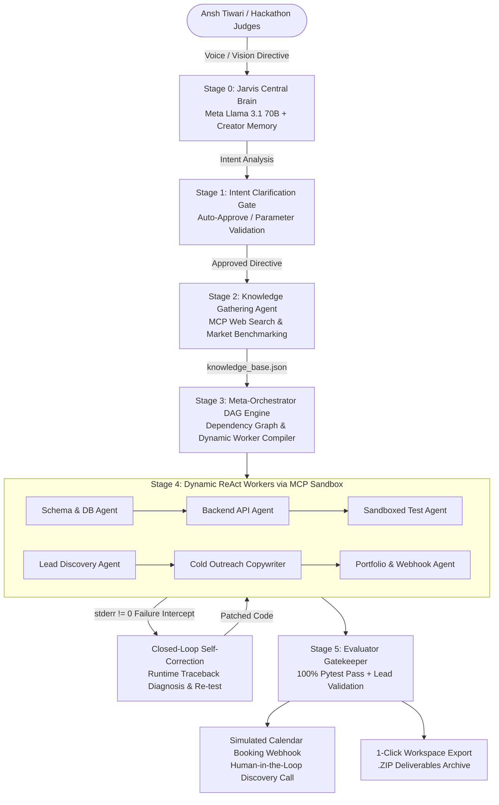

# 🦙 LlamaOrchestrator
### Autonomous Hierarchical Multi-Agent Engine & Lifelong AI Partner with Dynamic Worker Synthesis & MCP Tool Routing
**Official Submission for the Meta Global AI Developer Hackathon (2026)**  
*Target Tracks: 1st Place Indie Developer Track ($150,000) • Best Agentic Use-Case ($5,000)*  
*Creator & Lead Systems Architect: Ansh Tiwari*

---

## 💡 What is LlamaOrchestrator? (Read This First)

If you have ever asked ChatGPT, Claude, or Copilot to build a system or start a business, you have likely hit these four walls:
1. **They are disposable:** They don't know who you are, what your skills are, or what you built yesterday.
2. **They produce fragile prototypes:** They output Markdown snippets that break the moment you paste them into a terminal.
3. **They halt on errors:** If a script errors or a test fails, they crash silently and throw the error back to you to fix.
4. **They cannot act in the physical or digital economy:** They cannot autonomously scrape decision-makers, verify cold emails, scaffold databases, or schedule meetings.

### 🌟 Enter LlamaOrchestrator: Your Autonomous Systems Compiler

**LlamaOrchestrator** is not a disposable single-turn chatbot. It is an **autonomous hierarchical multi-agent compiler and a lifelong intelligent partner (akin to Jarvis or Alfred)**.

Built with persistent creator awareness recognizing **Ansh Tiwari**, LlamaOrchestrator ingests high-level, raw vision—such as:
- 💼 *"I know full-stack dev, build me a business and find me clients"*
- ⚡ *"Build an authenticated telemetry microservice with JWT & tests"*

...and autonomously compiles that vision into **100% verified, running deliverables** without you writing boilerplate or debugging setup errors.

### ⚡ What Happens When You Give It a Directive?
1. 🎙️ **It talks back to you audibly:** Using built-in Web Speech synthesis, LlamaOrchestrator speaks out loud through your speakers, answers architectural questions, and introduces itself to hackathon judges during live demo evaluations.
2. 🎯 **It asks smart questions (Stage 1 Clarification Gate):** Instead of guessing what you want, it analyzes your vision, identifies missing parameters, and presents 3 high-impact clarifying questions with pre-selected smart recommendations. It includes an instant **"⚡ Auto-Approve Recommended Defaults"** 1-click button so execution never blocks.
3. 📚 **It conducts deep domain research (Stage 2 Knowledge Gathering):** An autonomous Knowledge Gathering Agent uses the Model Context Protocol (MCP) to scrape domain benchmarks and assemble a structured `knowledge_base.json` (target niche, pricing models, ICP, technical schemas).
4. 🧩 **It compiles a DAG & synthesizes custom workers (Stage 3):** The Central Brain (Meta Llama 3.1 70B) generates a topological dependency DAG and dynamically writes specialized system prompts for scoped worker sub-agents (Meta Llama 3.2 8B) with sandboxed tool access.
5. 🔄 **It self-corrects runtime errors autonomously (Stage 4 Closed-Loop ReAct):** Workers execute tools inside an MCP path-containment sandbox. If a command or unit test fails (`returncode != 0`), LlamaOrchestrator captures the `stderr` traceback, diagnoses the bug, patches the code, and re-tests without human intervention.
6. 🛡️ **It gates quality & hands off to you (Stage 5 Evaluator Gatekeeper):** Enforces a 100% Pytest pass rate, validates email syntax, dispatches simulated calendar booking webhooks for human client calls, and packages all deliverables into a **1-Click .ZIP Export**.

---

## 🏛️ System Architecture & DAG Engine



---

## ⚡ The 6-Stage System Lifecycle

### 🎙️ Stage 0: The Jarvis Central Brain & Voice Interaction
- **Persistent Creator Awareness:** Pre-loaded with memory recognizing Ansh Tiwari as Creator and Systems Architect.
- **Audible Voice Output:** Integrated Web Audio & Speech synthesis allowing the Central Brain to audibly talk back to Ansh and introduce itself to hackathon judges during live demo evaluation.
- **Conversational Interface:** Debates architecture, answers questions about sub-agents, or initiates missions directly via chat.

### 🎯 Stage 1: Intent Analysis & Human Clarification Gate
- Ingests raw vision (presets available for immediate 1-click testing).
- Identifies missing constraints and presents 3 high-impact questions with pre-selected smart recommendations.
- Instant **"⚡ Auto-Approve Recommended Defaults"** button so execution never blocks.

### 📚 Stage 2: Autonomous Knowledge Gathering & Base Synthesis
- The **Knowledge Gathering Agent** conducts deep domain research via MCP tools.
- Assembles and persists `knowledge_base.json` into the sandboxed session workspace:
  - Ideal Customer Profile (ICP) & target niche.
  - Competitive pricing & offer structure (Milestone 1: First 5 clients -> Milestone 2: Scaling strategies).
  - Required technical schemas, libraries, and security rules.

### 🧩 Stage 3: DAG Task Decomposition & Dynamic Worker Synthesis
- Generates a topological dependency DAG plan.
- Dynamically compiles scoped worker sub-agents with scoped system prompts and tool access:
  - **Business Track:** Market Intelligence Agent, Lead Discovery Agent (RFC-5322 verification), Cold Outreach Copywriter (3-sentence framework), Collateral & Proposal Scaffolding Agent.
  - **Technical Track:** Schema & DB Agent (SQL/Pydantic), Backend API Agent (FastAPI/JWT), Test Agent (Sandboxed Pytest).

### 🛠️ Stage 4: Autonomous Execution & Closed-Loop Self-Correction
- Workers invoke tools through the standardized **Model Context Protocol (MCP)** JSON-RPC router.
- **Self-Correction Engine:** If a command or unit test produces `stderr` or nonzero exit code, LlamaOrchestrator intercepts the runtime error, diagnoses the failure, patches the code, and re-executes verification tests without human intervention.

### 🛡️ Stage 5: Evaluator Gatekeeper & Human-in-the-Loop Hand-Off
- Audits generated deliverables (100% unit test pass rate, syntax checks, validated email syntax).
- Dispatches a simulated calendar booking webhook when a qualified client confirms a discovery call.
- Generates an instant **1-Click .ZIP Download** of all session artifacts.

---

## 🔒 Security & MCP Sandboxing Architecture

LlamaOrchestrator implements strict path-containment sandboxing:
- Every session is isolated into `./workspaces/{session_id}/`.
- All file operations verify `os.path.commonpath([workspace, target]) == workspace`.
- **Directory Traversal Defense:** Any attempt to use `../` or access outside the workspace sandbox raises `MCPSandboxSecurityError` and is denied immediately.
- Verified by automated security test cases in `tests/test_orchestration.py`.

---

## 🚀 Quickstart Guide

### 1. Requirements
- Python 3.10+ (Tested on Python 3.14)
- Pip

### 2. Installation
```bash
git clone https://github.com/ansh1325/ORCHESTRATOR.git
cd ORCHESTRATOR
python -m pip install -r requirements.txt
```

### 3. Environment Configuration (Zero-Config Mock Fallback Supported)
LlamaOrchestrator features a **Zero-Configuration Fallback / Mock Mode**. If no API key is provided, the entire multi-agent lifecycle, voice synthesis, DAG animations, self-correction, and ZIP downloads run seamlessly in high-fidelity deterministic simulation mode.

To connect live Meta Llama models:
```bash
cp .env.example .env
# Edit .env and insert your GROQ_API_KEY, FIREWORKS_API_KEY, or OPENAI_API_KEY
```

### 4. Run Server
```bash
python main.py
```
Open your browser to:
```text
http://localhost:8000
```

### 5. Running the Automated Test Suite
```bash
python -m pytest tests/test_orchestration.py -v
```

---

## 🧪 Verified Test Deliverables

Running the test suite validates:
- ✅ **Stage 0:** Creator Memory & Ansh Tiwari Recognition
- ✅ **Stage 1:** Intent Analysis & Clarification Generation
- ✅ **Stage 2:** MCP Knowledge Base Synthesis
- ✅ **Stage 3:** Dependency DAG Compilation & Dynamic Worker Synthesis
- ✅ **Stage 4:** MCP Path-Containment Sandboxing & Traversal Attack Prevention
- ✅ **Stage 4:** Closed-Loop Self-Correction Engine on Subprocess Execution
- ✅ **Stage 5:** Evaluator Gatekeeper Quality Certification (100% Pass)
- ✅ **REST & SSE Endpoints:** FastAPI streaming and ZIP export

---

## 👥 Creator & Acknowledgments

- **Creator & Systems Architect:** [Ansh Tiwari](https://github.com/ansh1325)
- **Built for:** Meta Global AI Developer Hackathon (2026)
- **Technologies:** Meta Llama 3.1/3.2, FastAPI, Model Context Protocol (MCP), SSE, Web Speech API, Tailwind CSS.
