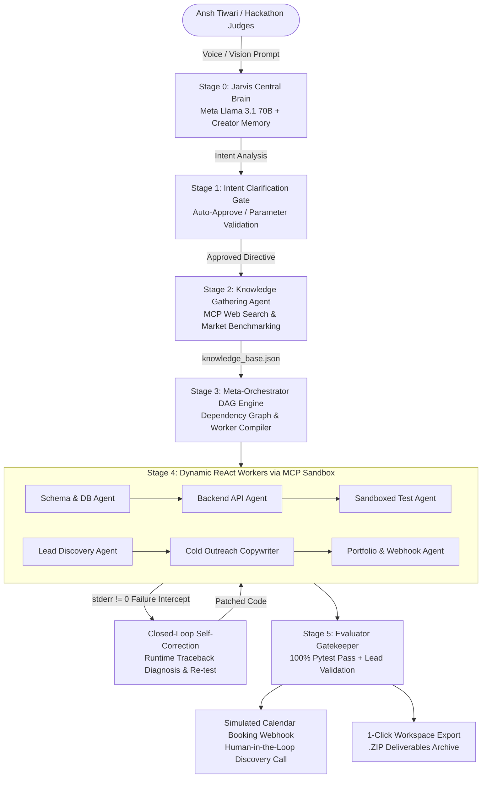

# 🦙 LlamaOrchestrator
### Autonomous Hierarchical Multi-Agent Engine with Dynamic Worker Synthesis & MCP Tool Routing
**Official Submission for the Meta Global AI Developer Hackathon**  
*Target Tracks: 1st Place Indie Developer Track ($150,000) • Best Agentic Use-Case ($5,000)*  
*Creator & Lead Systems Architect: Ansh Tiwari*

---

## 🌟 Executive Summary & Winning Vision

Most AI systems today are disposable, single-turn chatbots that forget who you are, hallucinate commands, and fail silently when code breaks. 

**LlamaOrchestrator** is an entirely different paradigm: an autonomous multi-agent compiler and a lifelong intelligent partner (akin to **Jarvis or Alfred**). Built with persistent creator awareness for **Ansh Tiwari**, it can ingest an ambitious vision—such as *"I know full-stack dev, build me a business and find me clients"* or *"Build an authenticated telemetry microservice"*—and autonomously transform that vision into verified, production-ready deliverables.

Powered by **Meta Llama 3.1 70B** as the Central Brain and **Meta Llama 3.2 8B** as dynamically synthesized workers, LlamaOrchestrator executes a rigorous **6-Stage System Lifecycle**:
1. **Audible Voice Central Brain:** Recognizes its creator and speaks aloud to hackathon judges via Web Speech synthesis.
2. **Clarification Gate:** Analyzes intent and identifies missing constraints with a 1-click **"⚡ Auto-Approve Recommended Defaults"** button.
3. **Autonomous Knowledge Gathering:** Leverages Model Context Protocol (MCP) tools to synthesize a structured `knowledge_base.json`.
4. **DAG Task Decomposition & Worker Synthesis:** Generates a topological execution graph and dynamically compiles scoped worker agents with system prompts and sandboxed tools.
5. **Closed-Loop Self-Correction:** Executes tools over MCP JSON-RPC, catching runtime `stderr` or nonzero returncodes and automatically diagnosing, patching, and re-testing without halting.
6. **Evaluator Gatekeeper:** Enforces a 100% test pass rate, validates email syntax, and dispatches simulated calendar booking webhooks for human hand-off.

---

## 🏗️ System Architecture & DAG Engine



---

## ⚡ The 6-Stage System Lifecycle

### 🎙️ Stage 0: The Jarvis Central Brain & Voice Interaction
- **Persistent Creator Memory:** Pre-loaded with persistent memory recognizing Ansh Tiwari as Creator and Systems Architect.
- **Audible Voice Output:** Integrated Web Audio & Speech synthesis allowing the Central Brain to audibly talk back to Ansh and introduce itself to hackathon judges during live demo evaluation.
- **Conversational Interface:** Debates architecture, answers questions about sub-agents, or initiates missions.

### 🎯 Stage 1: Intent Analysis & Human Clarification Gate
- Ingests raw vision (presets available for immediate 1-click testing).
- Identifies missing constraints and presents 3 high-impact questions with pre-selected smart recommendations.
- Instant **"⚡ Auto-Approve Recommended Defaults"** button so execution never blocks.

### 📚 Stage 2: Autonomous Knowledge Gathering & Base Synthesis
- The **Knowledge Gathering Agent** conducts deep domain research via MCP tools.
- Assembles and persists `knowledge_base.json` into the sandboxed session workspace:
  - Ideal Customer Profile (ICP) & target niche.
  - Competitive pricing & offer structure (Milestone 1: First 5 clients $\rightarrow$ Milestone 2: Scaling strategies).
  - Required technical schemas, libraries, and security rules.

### 🧩 Stage 3: DAG Task Decomposition & Dynamic Worker Synthesis
- Generates a topological dependency DAG plan.
- Dynamically compiles scoped worker sub-agents with scoped system prompts and tool access:
  - **Business Track:** Market Intelligence Agent, Lead Discovery Agent (RFC-5322 verification), Cold Outreach Copywriter (3-sentence framework), Collateral & Proposal Scaffolding Agent.
  - **Technical Track:** Schema & DB Agent (SQL/Pydantic), Backend API Agent (FastAPI/JWT), Test Agent (Sandboxed Pytest).

### 🛠️ Stage 4: Autonomous Execution & Closed-Loop Self-Correction
- Workers invoke tools through the standardized **Model Context Protocol (MCP)** JSON-RPC router.
- **Self-Correction Engine:** If a command or unit test produces `stderr` or nonzero exit code, LlamaOrchestrator intercepts the runtime error, diagnoses the failure, patches the code, and re-executes verification tests without human intervention.

### 🛡️ Stage 5: Evaluator Gatekeeper & Human-in-the-Loop Hand-Off
- Audits generated deliverables (100% unit test pass rate, syntax checks, validated email syntax).
- Dispatches a simulated calendar booking webhook when a qualified client confirms a discovery call.
- Generates an instant **1-Click .ZIP Download** of all session artifacts.

---

## 🔒 Security & MCP Sandboxing Architecture

LlamaOrchestrator implements strict path-containment sandboxing:
- Every session is isolated into `./workspaces/{session_id}/`.
- All file operations verify `os.path.commonpath([workspace, target]) == workspace`.
- **Directory Traversal Defense:** Any attempt to use `../` or access outside the workspace sandbox raises `MCPSandboxSecurityError` and is denied immediately.
- Verified by automated security test cases in `tests/test_orchestration.py`.

---

## 🚀 Quickstart Guide

### 1. Requirements
- Python 3.10+ (Tested on Python 3.14)
- Pip

### 2. Installation
```bash
git clone https://github.com/anshtiwari/LlamaOrchestrator.git
cd LlamaOrchestrator
python -m pip install -r requirements.txt
```

### 3. Environment Configuration (Optional for Live Llama Inference)
LlamaOrchestrator features a **Zero-Configuration Fallback / Mock Mode**. If no API key is provided, the entire multi-agent lifecycle, voice synthesis, DAG animations, self-correction, and ZIP downloads run seamlessly in high-fidelity deterministic simulation mode.

To connect live Meta Llama models:
```bash
cp .env.example .env
# Edit .env and insert your GROQ_API_KEY, FIREWORKS_API_KEY, or OPENAI_API_KEY
```

### 4. Run Server
```bash
python main.py
```
Open your browser to:
```text
http://localhost:8000
```

### 5. Running the Automated Test Suite
```bash
python -m pytest tests/test_orchestration.py -v
```

---

## 🧪 Verified Test Deliverables

Running the test suite validates:
- ✅ **Stage 0:** Creator Memory & Ansh Tiwari Recognition
- ✅ **Stage 1:** Intent Analysis & Clarification Generation
- ✅ **Stage 2:** MCP Knowledge Base Synthesis
- ✅ **Stage 3:** Dependency DAG Compilation & Dynamic Worker Synthesis
- ✅ **Stage 4:** MCP Path-Containment Sandboxing & Traversal Attack Prevention
- ✅ **Stage 4:** Closed-Loop Self-Correction Engine on Subprocess Execution
- ✅ **Stage 5:** Evaluator Gatekeeper Quality Certification (100% Pass)
- ✅ **REST & SSE Endpoints:** FastAPI streaming and ZIP export

---

## 👥 Creator & Acknowledgments

- **Creator & Systems Architect:** [Ansh Tiwari](https://github.com/anshtiwari)
- **Built for:** Meta Global AI Developer Hackathon (2026)
- **Technologies:** Meta Llama 3.1/3.2, FastAPI, Model Context Protocol (MCP), SSE, Web Speech API, Tailwind CSS.
